# Bi-static link budget: DVB-T, 600 MHz

*Final design, generated 2026-11-10*

## Summary

| Check | Result | Detail |
|---|---|---|
| Single-look Pd of 0.9 | Met | Pd 0.944, margin +2.7 dB |
| Single-look Pd at upper-decile noise | NOT MET | Pd 0.857, margin -1.7 dB |
| Front-end gain window and ADC | Met | Noise 16.4 dB above quantization at best, 14.2 of 16 bits needed |
| Track confirmation of 0.95 | Met | 0.998 at 0.57 false tracks per hour |

### Warnings

- Detection meets the requirement at median noise, but misses it by 1.7 dB at upper-decile noise. Noise can exceed this level about 10% of the time and locations.
- This target is fine, but at the design maximum speed (300 m/s) a target can cross 3.0 range cells in one coherent interval and lose up to 9.6 dB.

## Control parameters

| Parameter | Value |
|---|---|
| Operating frequency | 600.0 MHz |
| Waveform | DVB-T (8k) |
| Bandwidth, CPI | 7.61 MHz, 0.2 s |
| Transmit power and PA | 500 W mean envelope; PA saturated power 5610 W |
| Transmit antenna | Monopole, 30 m, ideal ground plane |
| Receive array | 16 dipole ring, radius 1.00 wavelengths; 0 in column |
| Digitization, taper, null | per element, uniform, null on Tx: on |
| ADC | 16 bits, 13.5 effective, 19 MS/s |
| Receiver gain | 33.1 dB, AGC range 11.3 dB |
| Pre-ADC suppression | 0.0 dB |
| Digital cancellation | 23.0 dB applied |
| Detector | Pfa 6.45e-11, 1 look(s), 32 CFAR cells |
| Relaxed per-look Pfa (with tracker) | 3.16e-05 |
| Track confirmation | 3 of 4, update 1 s |

### Scenario

| Item | Value |
|---|---|
| Baseline | 20.0 km |
| Target ranges | Rt 26.5 km, Rr 30.0 km |
| Bi-static angle | 40.9 deg |
| Bi-static range and Doppler | 36.5 km, -131 Hz |
| Target | 10.0 dBsm, Swerling 1, 1000 m altitude |

## Antennas

| Item | Value |
|---|---|
| Usable band (VSWR 2) | 574 to 627 MHz |
| Element spacing | 0.39 wavelengths |
| Gain toward target | 14.0 dBi |
| Gain toward transmitter | -27.0 dBi (null depth 28.0 dB) |
| Azimuth beamwidth, peak sidelobe | 21.0 deg, -7.9 dB |

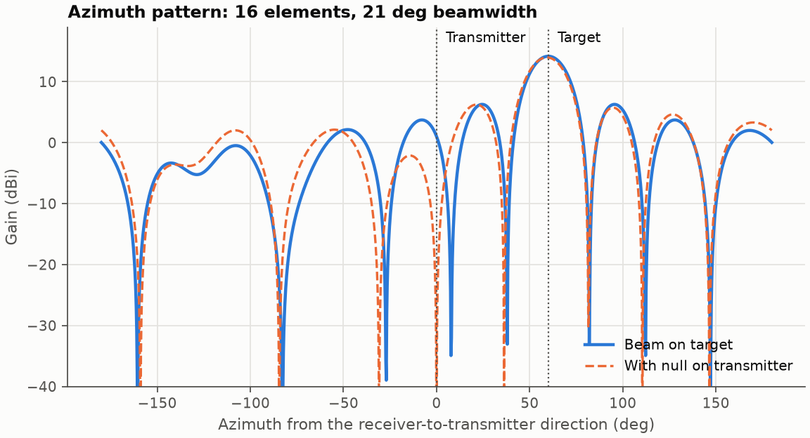

*Azimuth pattern with and without the null on the transmitter.*

## Stage 1: Noise

System noise temperature at the array output is 707 K (-170.1 dBm/Hz). The dominant source is receiver. Receiver noise is unchanged by beamforming (387 K), while external noise goes from 227 K per element to 320 K at the output.

*Noise sources considered, including those rejected.*

| Effect | Value | Used | Why | Reference | Validity note |
|---|---|---|---|---|---|
| Man-made noise | 101.17 K | Yes | P.372 median for the 'rural' category. Above 1% of receiver noise. | P.372-18 eq. 17, Table 1, Figs 3 and 39 | Estimate: 600 MHz is above the 250 MHz limit of eq. 17. Continues from there at the slope of Fig. 3 curve A, which is for city noise and stops near 900 MHz. Measure at the site if it matters. |
| Galactic and cosmic background | 13.98 K | Yes | Falls about 23 dB per decade, so it matters most at VHF and low UHF. | P.372-18 eq. 15, Fig. 3 curve B | Equation stated up to about 100 MHz; Fig. 3 curve B continues at close to the same slope, to about 5 GHz. |
| Atmospheric gases and rain emission | 10.67 K | Yes | Zenith gas absorption 0.032 dB; absorbers emit at about 275 K. | P.372-18 eq. 10 and 11, P.676, P.838 | 275 K is the P.372-18 rain value. Its clear-air Tmr data file is not bundled, so 275 K is used for clear air too. |
| Ground pick-up | 194.03 K | Yes | The dipole pattern is not shielded from the ground, which radiates at about 290 K. | Pattern integration | No mast or ground-plane image in this estimate. |
| Sun in beam | 0.00 K | No | Disabled: the beam is not assumed to point at the Sun. | P.372-18 Fig. 3 curve D | Read from the figure. A disturbed Sun can be far higher. |
| Lightning (atmospheric) noise | 0.00 K | No | Rejected: an HF and lower-VHF effect, negligible against man-made and galactic noise at 50 MHz and above. | P.372-18 Part 5, Fig. 2 |  |

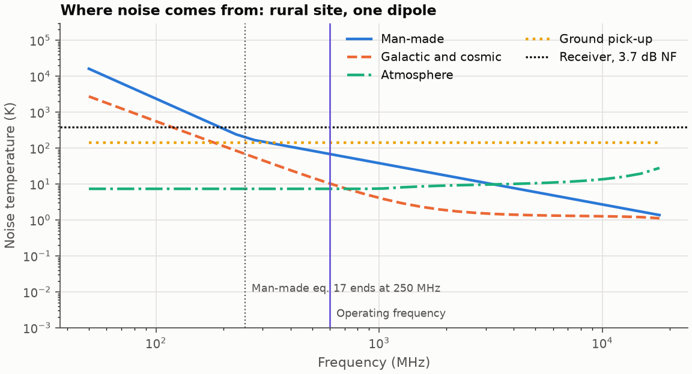

*Noise sources across the frequency range.*

### Noise spread

Noise is at or under 2036 K for about 90% of times and locations, 4.6 dB above the sum of medians. The design point is median noise. Table 2 is an average for 0.3 to 250 MHz, used here beyond its range. Older outdoor measurements at 322-425 MHz (P.372-13) show smaller deviations, so this margin may be pessimistic. Enter measured deviations if available.

*P.372-18 Part 7, applied to man-made and galactic noise; other sources are treated as constant.*

| Quantity | Value |
|---|---|
| System noise, lower decile | 609 K |
| System noise, Part 7 median | 696 K |
| System noise, sum of medians | 707 K |
| System noise, upper decile | 2036 K |
| Constant part (receiver, ground, atmosphere) | 591 K |
| Man-made decile deviations, upper and lower | 11.4 dB, 8.2 dB |
| Pd at median noise | 0.944 |
| Pd at upper-decile noise | 0.857 |

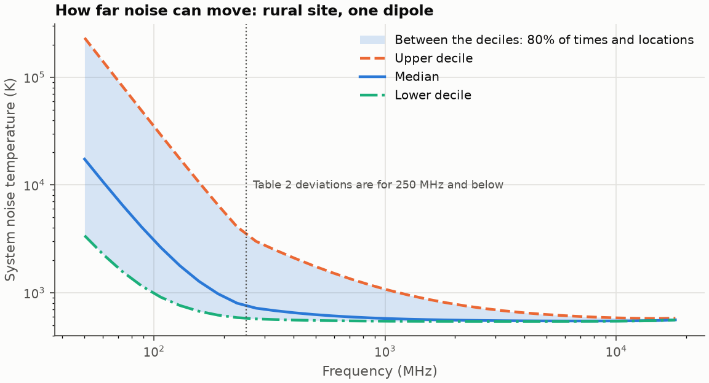

*System noise and its decile band.*

## Stage 2: Direct path and RF front-end

EIRP toward the receiver is 31.2 dBW. Direct signal per element: maximum -47.8 dBm, nominal -59.1 dBm, minimum -59.1 dBm. Free-space level plus 3.0 dB: in-phase ground ray or ducting. Diffraction is removed, because ducting can lift a blocked path to near free space.

*Propagation mechanisms on the direct path, and why each was used or rejected.*

| Effect | Value | Used | Why | Reference | Validity note |
|---|---|---|---|---|---|
| Free-space loss | 114.03 dB | Yes | Always applies: the basic spreading of the wave. | P.525 |  |
| Refraction (k-factor) | 1.34  | Yes | Refractivity gradient -40 N/km gives an effective Earth radius of 8549 km. | P.453 |  |
| Diffraction: Spherical Earth | 8.30 dB | Yes | Clearance 15.1 m against the 26.6 m needed for zero loss: line of sight with too little clearance. The ray grazes or crosses the surface, so it applies. | P.526 sec. 3.2 |  |
| Atmospheric gases | 0.11 dB | Yes | Specific attenuation 0.0054 dB/km over this path is significant. | P.676 | P.676 starts at 1 GHz; the 1 GHz value is used as an upper bound. |
| Rain attenuation | 0.00 dB | No | Disabled: the rain rate is zero. | P.838, P.530 sec. 2.4.1 |  |
| Ground reflection (two-ray) | 0.00 dB | No | Rejected: the diffraction model already accounts for the ground on this path. | P.526 |  |
| Clear-air multipath fade | 0.00 dB | No | Rejected: 0.60 GHz is below the P.530 lower limit of about 0.75 GHz for 20 km. | P.530 sec. 2.3.1 |  |
| Terminal clutter loss | 0.00 dB | No | Disabled: no terminal on this path is set as inside clutter. | P.2108 sec. 3.2 |  |

### Dynamic range

With 13.5 effective bits at 19 MS/s the ADC offers 84.0 dB of instantaneous range. Less 13.5 dB of back-off and the 54.1 dB direct-to-noise ratio at the ADC input, noise can sit at most 16.4 dB above quantization, and 11.2 dB in operation. The gain must lie between 21.9 and 38.3 dB. Quantization costs 0.32 dB at the nominal level and 0.32 dB at the maximum level. Digitizing each element means the direct signal reaches each ADC before beamforming, so a digital null cannot help the ADC.

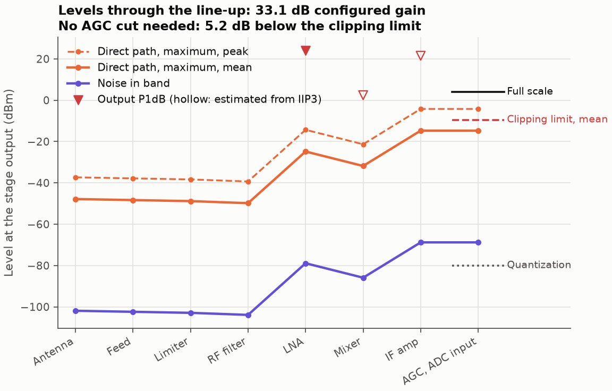

*Maximum direct signal and noise through the line-up, with compression points and the AGC cut.*

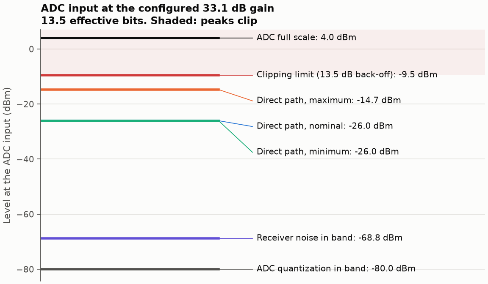

*Levels at the ADC input, at the gain the AGC sets for the nominal direct level.*

### Derived requirements

| Requirement | Needed | This design | Status | Why |
|---|---|---|---|---|
| Noise above quantization | Computed | 16.4 dB at best; 11.2 dB in operation | Not rated | Instantaneous range 84.0 dB at 19 MS/s, minus 13.5 dB back-off, minus a 54.1 dB direct-to-noise ratio at the ADC input. Costs 0.32 dB of sensitivity at the nominal direct level and 0.32 dB at the maximum. |
| Receiver gain window | Non-empty window | 21.9 to 38.3 dB (16.4 dB wide) | Met | From the gain that lifts noise to the quantization level, up to the gain at which the strongest signal clips. |
| ADC resolution | 14.2 bits (11.7 effective) | 16 bits (13.5 effective) | Met | An ideal ADC would leave 3.0 dB of detection margin. At the maximum direct signal, quantization must cost no more than that, so noise must sit at least 0.1 dB above quantization; this design gives 11.2 dB (0.32 dB loss). |
| Configured gain vs window | Inside the window | 33.1 dB | Met | Line-up gain set on the front-end page. |
| AGC range | 11.3 dB | Must be fitted if over about 3 dB | Not rated | Maximum minus minimum direct path at one element. Backing off at the nominal level costs 0.32 dB of sensitivity; at the maximum level, 0.32 dB. |
| Limiter threshold | -39.3 to 30.0 dBm at the LNA input | LNA survives 30.0 dBm | Met | Above the highest normal peak so it stays out of normal operation, and below the LNA's survival level. |
| LNA input P1dB | -36.3 dBm or more | 0.0 dBm | Met | Peak direct signal at the LNA input (-49.8 dBm plus PAPR) with 3 dB margin. |
| LNA gain | 20.4 dB or more | 25.0 dB | Met | Keeps later stages from degrading noise figure by more than 0.5 dB. |
| Cascade input IP3 | -20.8 dBm or more | -5.2 dBm | Met | Puts third-order products from the direct signal at or below in-band noise. At the nominal level they sit 108 dB below the direct signal, and that distortion is counted in the target's SINR. |
| Suppression before the ADC | 0.0 dB | 0.0 dB fitted | Met | Only an analog null or RF canceller can close a gain-window shortfall. A digital null cannot. |
| Digital cancellation after the ADC | 23.0 dB | Limit 50.0 dB | Met | Puts the direct-path leakage (-61.8 dB from DVB-T (8k)) in the target's cell 10 dB below integrated noise. ECA-type cancellation suits continuous waveforms. |
| LO phase noise at target Doppler | -87.8 dBc/Hz or better | -110.0 dBc/Hz | Met | 6 dB under receiver noise density, for the -88.3 dBm direct signal after beamforming. Assumes one LO shared across channels, so the spatial null also helps. The phase-noise skirt of the direct signal is counted in the target's SINR. |
| Transmitter PA saturated power | 5610 W | 500 W mean envelope; 500 W average | Not rated | Mean envelope power plus 10.5 dB back-off for DVB-T (8k). Duty cycle 1.00 sets the average heat load. |

*Receiver line-up for one channel.*

| Stage | Gain (dB) | NF (dB) | IIP3 (dBm) | Cumulative gain (dB) | Cumulative NF (dB) |
|---|---|---|---|---|---|
| Feed | -0.5 | 0.5 | - | -0.5 | 0.5 |
| Limiter | -0.5 | 0.5 | - | -1.0 | 1.0 |
| RF filter | -1.0 | 1.0 | - | -2.0 | 2.0 |
| LNA | 25.0 | 1.5 | 15.0 | 23.0 | 3.5 |
| Mixer | -7.0 | 7.0 | 20.0 | 16.0 | 3.54 |
| IF amplifier | 17.1 | 6.0 | 15.0 | 33.1 | 3.68 |

## Stage 3: Target, detection and estimation

*Target link budget.*

| Term | Value |
|---|---|
| EIRP toward target | 31.1 dBW (Tx gain 5.2 dBi) |
| Receive gain | 14.0 dBi |
| Target RCS | 10.0 dBsm |
| Excess path loss, Tx and Rx sides | -0.7 dB, -1.0 dB |
| System losses | 4.7 dB |
| of which migration: range, Doppler | 0.13 dB, 0.00 dB (0.33 and 0.04 cells crossed) |
| Received target power | -134.9 dBm |
| Processing gain | 60.5 dB |
| In the target's cell: noise | -163.1 dBm |
| In the target's cell: direct-path residual | -173.1 dBm |
| In the target's cell: clutter | -222.4 dBm |
| In the target's cell: LO phase noise of the direct signal | -191.3 dBm |
| In the target's cell: third-order distortion of the direct signal | -258.1 dBm |
| SNR, SINR | 28.2 dB, 27.8 dB |
| Pfa, search cells | 6.45e-11, 3.1e+07 |
| Required SINR, CFAR loss | 25.1 dB, 1.68 dB |
| Pd, margin | 0.944, +2.7 dB |
| Maximum Rt x Rr at required Pd | 1079 km^2 |

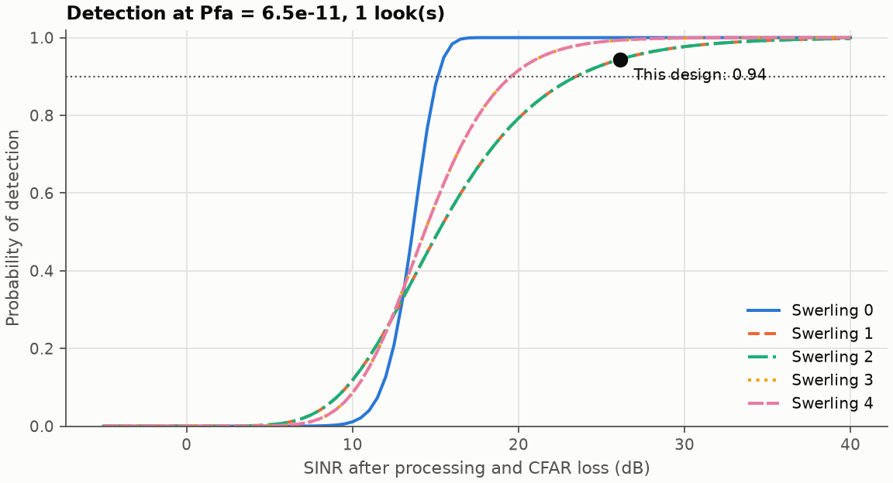

*Detection probability for each fluctuation model.*

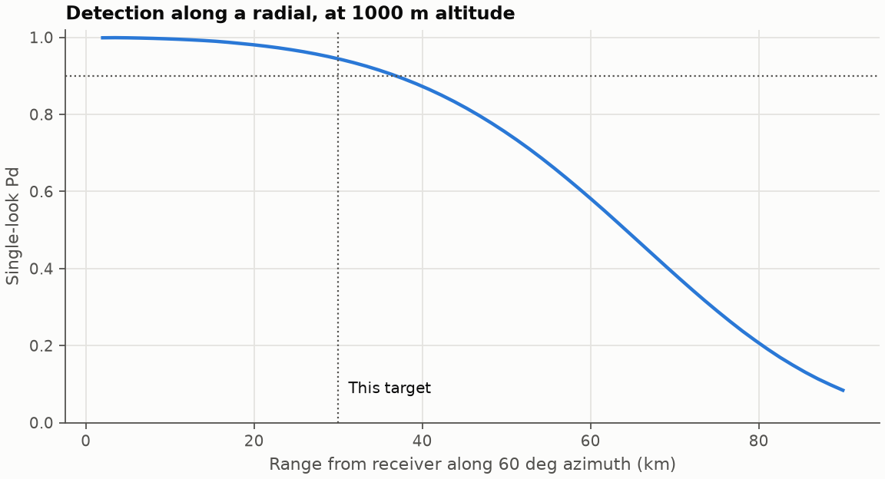

*Detection along a radial from the receiver.*

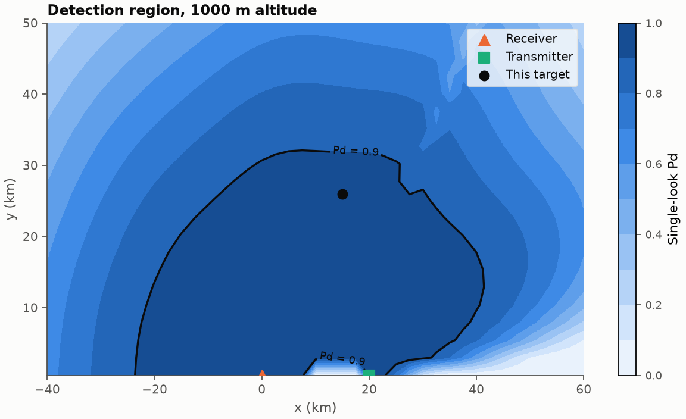

*Detection region over the Tx-Rx plane, for one half-plane.*

### Estimation

Accuracy bounds are valid here: SINR is 27.8 dB against an estimated threshold of 16.3 dB.

| Parameter | Single-look sigma | Resolution |
|---|---|---|
| Bi-static range | 0.6 m | 21 m along the bisector |
| Doppler | 0.079 Hz | 5.00 Hz |
| Range rate | 0.040 m/s | - |
| Azimuth | 0.36 deg | 21.0 deg beam |
| Elevation | Not available | - |
| Position (rms) | 203 m (x 200, y 34) | - |
| RCS | 0.25 dB from noise, 4.35 dB with fluctuation | - |

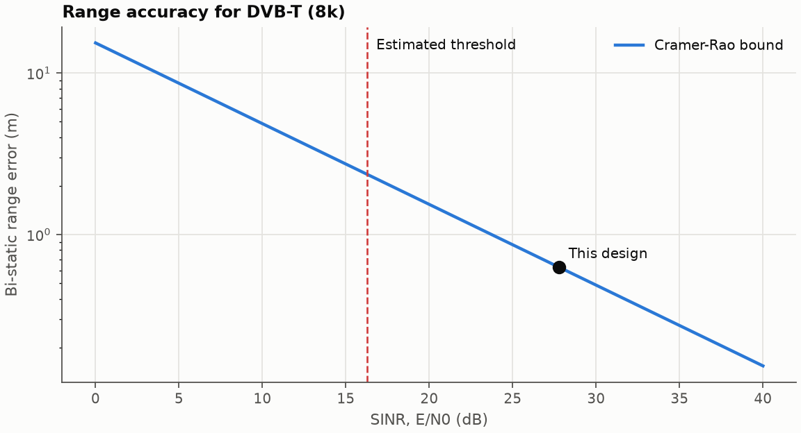

*Range accuracy bound and threshold.*

## Stage 4: Tracker

M-of-N confirmation allows a lower per-look threshold. Per-look Pfa can rise from 6.45e-11 to 3.16e-05, reducing the required SNR by 6.6 dB at 0.57 false tracks per hour. Confirmation takes about 3.1 scans (3.1 s). This is the price of the gain.

*Analytic tracker results.*

| Measure | Single look | With tracker |
|---|---|---|
| Pd (per look / confirmed track) | 0.944 | 0.980 / 0.998 |
| False reports per hour | 36 false alarms | 0.57 false tracks |
| Bi-static range sigma | 0.63 m | 0.16 m (+12.1 dB) |
| Range-rate sigma | 0.040 m/s | 0.040 m/s (-0.1 dB) |

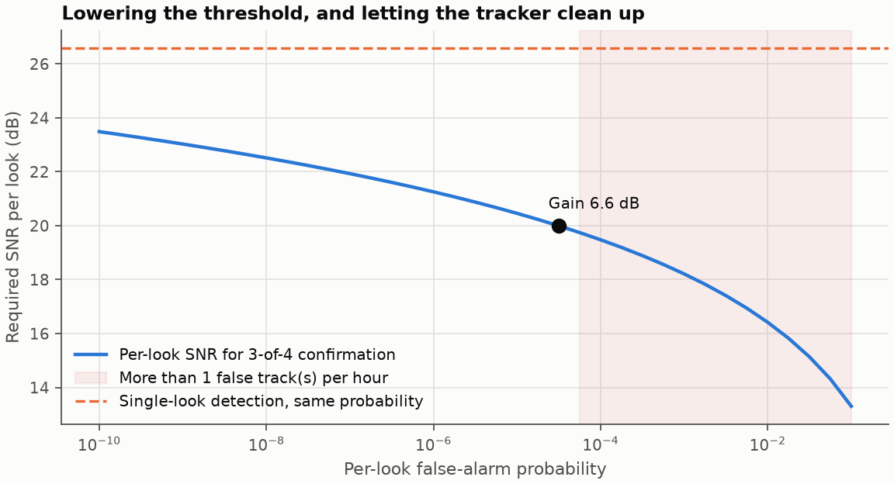

*Threshold trade: tracker gain.*

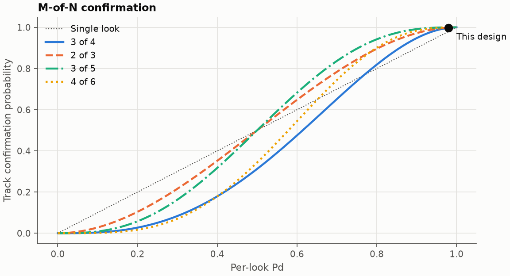

*M-of-N confirmation probability.*

### Monte Carlo

200 runs with seed 1; pda association. Track continuity 100.0%. Mean position error over the last third of the run is 80 m, against a single-look bound of 230 m.

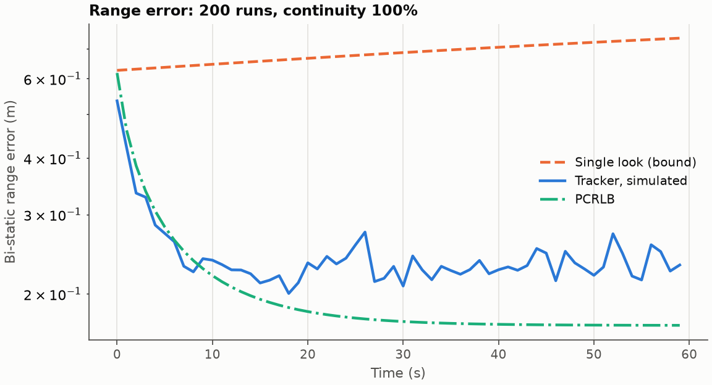

*Simulated range error against the single-look bound and the PCRLB.*

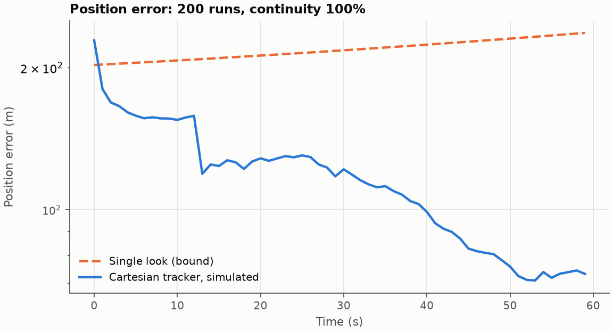

*Simulated Cartesian position error.*

## Limitations and notes

- Scattered pilots produce ambiguities starting near 90 km of path; reference conditioning should suppress them.
- Man-made noise above 250 MHz is an estimate from the slope of P.372-18 Fig. 3, so measure at the site if it matters.
- Part 7 noise statistics treat receiver, ground and atmosphere noise as constant. Table 2 deviations are averages for 0.3 to 250 MHz, and may be pessimistic above that.
- Array patterns ignore mutual coupling, which affects close-spaced arrays and deep nulls most.
- The direct-path maximum is an engineering upper bound, not a statistic.
- Accuracy bounds and tracked errors reflect noise only. Timing and synchronization errors, hardware drift and target extent add error floors in a real system.
- Ground constants are representative classes, not the full P.527-6 model.
- Geoclimatic K and dN75 are inputs, because the P.530 data grids are not bundled.
- Results cover one Tx-Rx pair. Multi-static operation and DEM terrain lookup are extension paths.

## References and verification status

| Source | Status | Note |
|---|---|---|
| Rec. ITU-R P.372-18 (09/2026), Radio noise | Equations read from this edition | Fig. 3 values are read from the curves, to about 1 dB. Man-made noise above 250 MHz is an estimate. The clear-air Tmr data file is not bundled. Part 7 is applied to man-made and galactic noise only. |
| Rec. ITU-R P.525-5 (11/2024), Calculation of free-space attenuation | Textbook result | Standard Friis result. |
| Rec. ITU-R P.526-16 (11/2025), Propagation by diffraction | Equations read from this edition |  |
| Rec. ITU-R P.530-19 (09/2025), Propagation data and prediction methods for terrestrial line-of-sight systems | Equations read from this edition | The LogK.csv and dN75.csv grids are not bundled, so K and dN75 are user inputs. |
| Rec. ITU-R P.2108-1 (09/2021), Prediction of clutter loss | Equations read from this edition |  |
| Rec. ITU-R P.676, Attenuation by atmospheric gases | Through the ITU-Rpy package | ITU-Rpy implements P.676-12. |
| Rec. ITU-R P.838-3, Specific attenuation model for rain | Through the ITU-Rpy package |  |
| Rec. ITU-R P.453-14 (08/2019), The radio refractive index | Representative values only | Only the k = 157/(157 + dN) relation and the duct threshold dN/dh < -157 N/km. |
| Rec. ITU-R P.527-6 (09/2021), Electrical characteristics of the surface of the Earth | Representative values only | Representative permittivity and conductivity per ground class, not the frequency-dependent soil model of P.527-6. |
| N. J. Willis, Bistatic Radar, 2nd ed., SciTech, 2005 | Textbook result |  |
| H. D. Griffiths and C. J. Baker, An Introduction to Passive Radar, Artech House, 2017 | Textbook result |  |
| M. A. Richards, Fundamentals of Radar Signal Processing, 2nd ed., McGraw-Hill, 2014 | Textbook result |  |
| D. A. Shnidman, Determination of required SNR values, IEEE Trans. AES 38(3), 2002 | Textbook result |  |
| W. J. Albersheim, A closed-form approximation to Robertson's detection characteristics, Proc. IEEE 69(7), 1981 | Textbook result |  |
| P. Swerling, Probability of detection for fluctuating targets, IRE Trans. IT-6, 1960 | Textbook result |  |
| H. L. Van Trees, Detection, Estimation and Modulation Theory, Parts I and IV, Wiley | Textbook result |  |
| Y. Bar-Shalom, X. R. Li and T. Kirubarajan, Estimation with Applications to Tracking and Navigation, Wiley, 2001 | Textbook result |  |
| P. R. Kalata, The tracking index, IEEE Trans. AES 20(2), 1984 | Textbook result |  |
| M. L. Hernandez, A. Farina and B. Ristic, A PCRLB for tracking in cluttered environments, IEEE Trans. AES 42(3), 2006 | Textbook result |  |
| C. A. Balanis, Antenna Theory, 4th ed., Wiley, 2016 | Textbook result |  |
